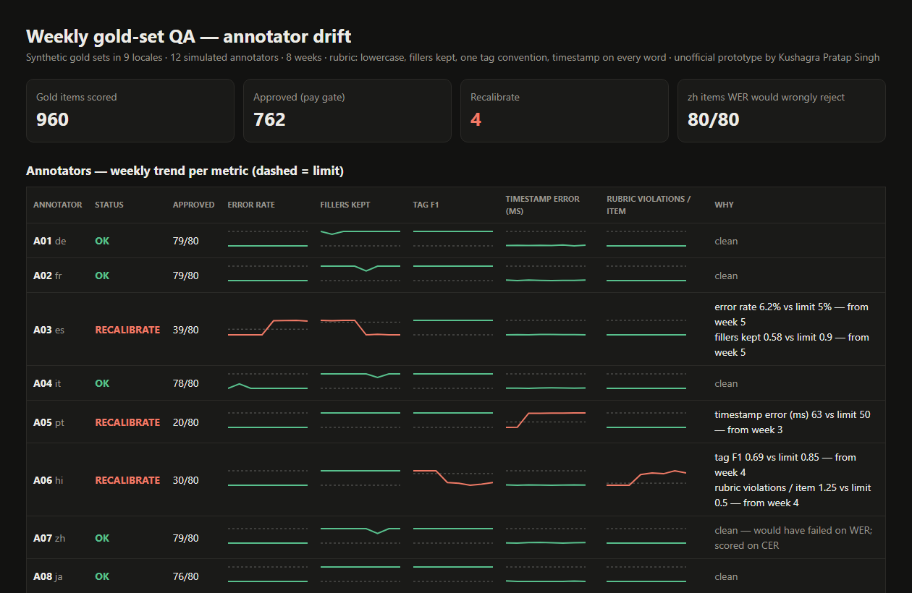

# Gold-Set QA + Annotator Drift Monitor

> Unofficial prototype by Kushagra Pratap Singh. Not affiliated with Perit.

## The problem

Perit's transcription rubric is "lowercase, fillers kept, one written convention for every tag, and a timestamp on every word — so accuracy and latency can be scored apart". Their quality loop is a "calibration gate before payment" and "weekly reviewer recalibration against gold sets to prevent drift", checked against WER ([perit.ai](https://perit.ai)). They have 650 transcribers and aligners across 9 locales, and contributors are paid per *approved* unit.

A single WER number hides most of what drifts:

- an annotator who slides into "clean verbatim" and **drops fillers**
- **tag spellings** that drift: `(pause)`, `[Overlap]`
- a **constant timestamp offset** from a misconfigured tool, where the words are perfect and the timing is wrong
- **zh / ja / ko**: WER depends on where the spaces go, so a perfect Chinese transcript with different word segmentation fails WER completely

## What I built

A stdlib Python scorer and drift monitor for the weekly gold-set loop.



```
960 gold items · 12 annotators · 8 weeks · scored in 1.3s

RECALIBRATE
  A03 (es)  fillers kept 0.58 vs limit 0.9 — from week 5
  A05 (pt)  timestamp error (ms) 63 vs limit 50 — from week 3
  A06 (hi)  tag F1 0.69 vs limit 0.85 — from week 4
  A06 (hi)  rubric violations / item 1.25 vs limit 0.5 — from week 4
  A10 (de)  error rate 5.2% vs limit 5% — from week 6

CJK trap: zh annotator A07 — WER would reject 80/80 items; CER rejects 1/80 (same characters, different word spaces)
```

| Piece | What it does |
|---|---|
| **Rubric validator** | Flags unknown or variant tag spellings, uppercase, missing timestamps, and non-monotonic or out-of-audio timestamps |
| **Accuracy** | WER from a Levenshtein word alignment, or **CER for zh/ja/ko**. Both are kept so the trap is visible |
| **Fillers** | Recall of locale-specific fillers (äh, euh, eh, मतलब, 那个, えーと, 음…), counted in the character stream for CJK |
| **Tags** | F1 over the allowed tag set |
| **Timing** | Median start-time error on aligned, matching words, and the share within 50 ms. Scored separately from accuracy, as their rubric intends |
| **Pay gate** | An item is approved only if every check passes, and each rejection says why |
| **Drift** | A weekly **EWMA** per annotator per metric against its limit, reporting the first week it crosses. Output: the recalibration list with the reason and week |

**About the data:** the gold sets are synthetic: short call-centre sentences I wrote in Perit's 9 locales, with fillers, tags and word timestamps. The 12 annotators are simulated from gold with planted behaviours: filler dropping from week 5, a +120 ms offset from week 3, tag variants from week 4, careless from week 6, CJK re-segmentation, and 7 clean. All planted behaviours are flagged in the right week and no clean annotator is flagged (`tests/`). The thresholds (5% error, 50 ms, 90% fillers) are placeholders, not Perit's real numbers.

## Run it (3 commands)

```bash
pip install -r requirements.txt     # only pytest; the tool is stdlib
python demo.py                      # writes out/dashboard.html
python -m pytest -q                 # 12 tests
```

## Next steps (not built)
Load real gold items and annotator exports (JSON/CTM/TextGrid), make per-locale thresholds configurable, add inter-annotator agreement on overlapping items, and send an auto-generated "here's what drifted" note to each flagged annotator before their recalibration session.

---
Unofficial prototype by Kushagra Pratap Singh. Not affiliated with Perit.
